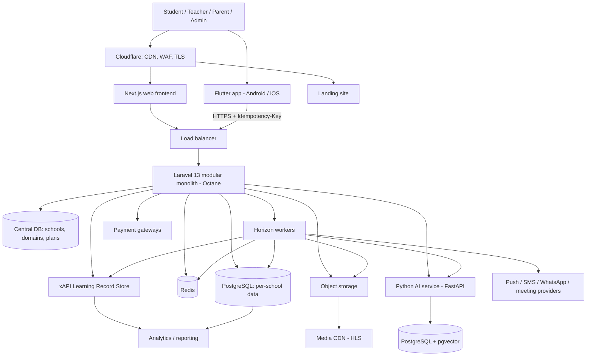
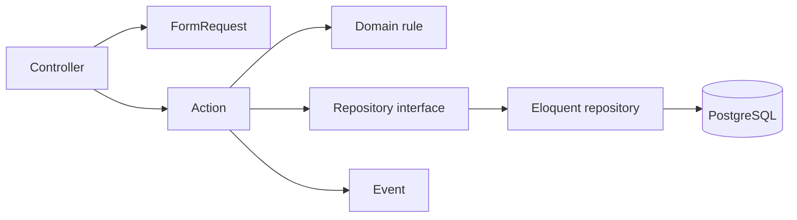
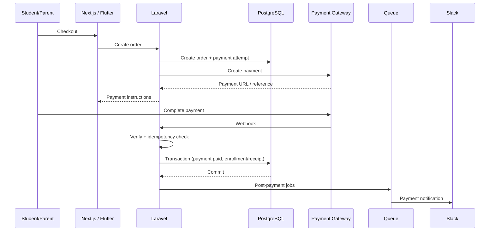
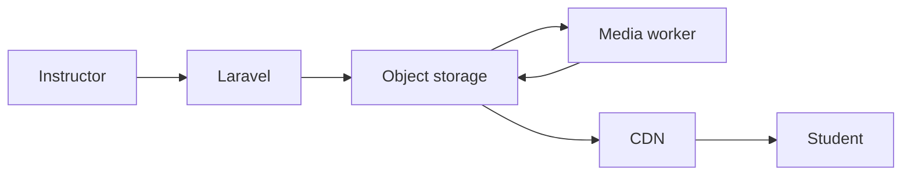
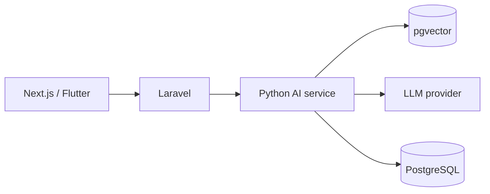
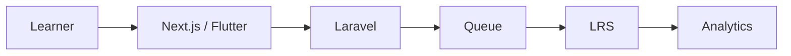

# مُدرّسى (Mudarisy) — Project Engineering Constitution

> The mandatory engineering rules for the Mudarisy platform: a multi-school learning-management SaaS
> (Laravel API + Flutter mobile app + Next.js web + landing site + AI service + xAPI/LRS).
>
> This constitution merges the generic "LMS Engineering Constitution + xAPI" with what Mudarisy already is:
> multi-tenant (a database per school), offline-first on mobile, QR/face attendance. **Nothing from the
> original is dropped**: courses, lessons, media, checkout and orders, subscriptions, certificates, xAPI/LRS,
> AI/RAG, Next.js, Slack alerts, Redis, Octane, pgvector are all requirements. Rules specific to our
> platform (tenancy, offline, trial accounts) are added.
>
> Business requirements are supplied separately and are implemented according to these rules.
>
> **Status markers.** **[NOW]** = true of the code today. **[BUILD]** = required by this constitution and
> not built yet: build it when its feature is scheduled, to these rules. Do not pretend a **[BUILD]** item exists.

---

# 1. Mission

Mudarisy is a high-scale learning platform for many schools, academies and tutoring centres, supporting:

- Schools (tenants), each with its own data, domain, plan and enabled modules
- Roles: admin, teacher/instructor, student, parent
- Groups (classes), schedules, lesson days; students and their QR/face cards
- Courses, sections, lessons; video, audio and document lectures
- Live and physical attendance (QR, face, manual, meeting provider), automatic absence
- Duties (homework), teacher agenda, worksheets, assignments, quizzes, exams, results, exam papers (PDF)
- Learning progress, enrollments
- Orders, checkout, payments, fees, subscriptions
- Certificates
- Chat, calls, live sessions; notifications (push, SMS, WhatsApp, in-app)
- Search, AI assistance, RAG
- Learning analytics, xAPI, LRS integration
- Reports and administration

It must be designed from the beginning for horizontal scalability, high availability, low latency, strong data
integrity, strict tenant isolation, secure payments, secure private media, asynchronous processing, large
learning-event volumes, AI workload isolation, offline-first mobile use, observability, maintainability and
future service extraction. The target workload may reach thousands of requests per second, so never assume a
single server or low data volume.

---

# 2. Core Architecture

**Modular Monolith (Laravel, multi-tenant) + separate AI service + xAPI/LRS + offline-first Flutter client +
Next.js web.** Do NOT begin with unrestricted microservices.



**[NOW]** One Laravel app with modules under `Modules/`, school resolved by domain, one SQLite file per school
plus a central file, Sanctum tokens, idempotent writes, Flutter app with offline layer, Blade landing page.
**[BUILD]** PostgreSQL, Redis + Horizon, Octane, object storage + CDN, Next.js, AI service, LRS, Sentry/Slack.

The system stays simple enough to develop and operate while being structurally ready for extraction.

---

# 3. Principles

```text
SOLID · KISS · DRY · YAGNI · Separation of concerns · Dependency inversion
Composition over inheritance where appropriate · Domain-oriented design
Explicit boundaries · Measure before optimising
Tenant isolation above convenience · Offline-first for field use
```

Architecture solves real problems. Do not add complexity merely because a pattern or technology exists.

---

# 4. Mandatory Technology Stack

## Backend
- PHP **8.4+** (verified on 8.5), **Laravel 13** (stay on the latest minor)
- **Laravel Octane**, **Laravel Horizon**
- **PostgreSQL** (source of truth) — **[NOW]** SQLite per school during development
- **Redis** (cache, queues, rate limits, locks) — **[NOW]** file/sync drivers
- **pgvector**
- Larastan, Laravel Pint, PHPUnit (or Pest)
- `nwidart/laravel-modules` for module boundaries; `stancl/tenancy` for multi-tenancy
- Laravel Sanctum for tokens
- `laravel/boost` as a dev dependency (see section 5)

## AI
Python · FastAPI · PostgreSQL + pgvector · LLM APIs · Embedding APIs

## Web frontend
Next.js · React · TypeScript · App Router

## Mobile
Flutter (Dart), Arabic/RTL first. MVVM: View → ViewModel (`Command0/Command1`) → Repository → Service; Riverpod
with `config/dependencies.dart` and `config/view_models.dart` as the composition root. Architecture tests:
widgets never import `data/` or `config/`; every declared package is used; no raw colours outside the theme.

## Marketing site
Blade landing page with self-hosted GSAP + ScrollTrigger.

## CI/CD
GitHub Actions.

## Observability
Sentry · Laravel Horizon · structured application logs · infrastructure metrics · PostgreSQL monitoring ·
Redis monitoring · Slack operational alerts.

---

# 5. Laravel Boost

Laravel Boost MUST be installed as a development dependency. Use Boost documentation and project guidance
when available; Boost rules complement, not contradict, this constitution.

Before implementing Laravel functionality, inspect: the relevant Laravel docs, the relevant package docs,
project-specific rules and existing project patterns. Do not use outdated patterns when the installed Laravel
version offers a better, current mechanism.

---

# 6. Modular Monolith and Module Ownership

The backend is a modular monolith. Target module list (the list may evolve with requirements):

```text
Modules/
├── Tenancy/        schools, domains, plans, module activation, locking        [NOW]
├── Auth/           users, roles, tokens, trial/expiry/disable controls        [NOW]
├── Students/       students, cards (QR token, face template), accounts        [NOW]
├── Groups/         groups (classes), schedules, sessions of the day           [NOW]
├── Attendance/     sessions, records, scans, auto-absence, reminders          [NOW]
├── Learning/       duties, agenda, worksheets, assignments                    [NOW]
├── Exams/          exam results, departments, question bank, paper PDFs       [NOW]
├── Payments/       payments, fees, desk QR check-in, online gateways          [NOW]
├── Chat/ Calls/    conversations, live calls, meeting providers               [NOW]
├── Notifications/  inbox, push/SMS/WhatsApp, device tokens                    [NOW]
├── Reports/        dashboards and summaries                                   [NOW]
├── PluginStore/    module catalogue, per-school installs                      [NOW]
├── Core/           shared kernel                                              [NOW]
├── Instructor/     instructor profiles                                        [BUILD]
├── Course/ Catalog/ courses, sections, lessons, versions, discovery           [BUILD]
├── Enrollment/     learner enrollment lifecycle                               [BUILD]
├── Commerce/       carts, orders, checkout                                    [BUILD]
├── Subscription/   plans for learners and for schools                         [BUILD]
├── Certification/  eligibility rules, issuance                                [BUILD]
├── Media/          upload, transcoding, signed delivery                       [BUILD]
├── Search/         course/student/content search                              [BUILD]
├── LearningRecord/ xAPI statements, outbox, LRS delivery                      [BUILD]
├── AI/             integration with the AI service, quotas                    [BUILD]
├── Analytics/      learning and operational analytics                         [BUILD]
└── Administration/ platform-level administration                              [BUILD]
```

Each module owns its business behaviour and persistence:

```text
Course        course lifecycle            Enrollment   learner enrollment lifecycle
Attendance    attendance state            Certification eligibility and issuance
Payments      payment state, gateways     LearningRecord xAPI integration and delivery
Tenancy       school lifecycle and plans  AI           AI quotas, usage, service calls
```

An unrelated module must not manipulate another module's internals: call its public actions/contracts or
listen to its events.

Recommended module layout (create folders only for real responsibilities):

```text
Modules/<Name>/
├── Config/  Database/{Migrations,Seeders,Factories}/  routes/api.php  Providers/
├── Http/{Controllers,Requests,Resources}/
├── Models/  DTOs/  Actions/  Services/  Repositories/{Contracts,Eloquent}/
├── Policies/  Events/  Listeners/  Jobs/  Notifications/
└── Tests/{Feature,Unit}
```

---

# 7. Multi-Tenancy (outranks convenience)

1. **Isolation is absolute.** Every query touching school data runs in the school's tenant context. A bug
   showing one school another's data is a security incident.
2. **School resolved from the request domain** (subdomain or custom domain), never from a header or body
   field. In production an unknown or central domain gets 404. `DEFAULT_SCHOOL` is local/testing only and must
   never be set in production.
3. A school has a slug, domains, a plan (student limit, enabled modules) and a state (active/locked). A locked
   school gets a clear refusal on every request.
4. Tenant database names, domains and plan limits come from configuration/central data, never from user input.
5. The isolation suite (`SchoolIsolationTest`) must pass with `DEFAULT_SCHOOL` **unset**.
6. Cache keys, queue jobs, files, search indexes, vector rows and xAPI actors are tenant-scoped (school id in
   the key / metadata).
7. Plan limits are enforced in the backend, not only the app.
8. Trial/temporary accounts carry `expires_at`/`disabled_at`; an expired or disabled account loses its
   sessions immediately and cannot sign in. Trial limits (groups, students, blocked writes, devices) live in
   `config/trial.php` and are enforced by middleware.

---

# 8. Layering, SOLID, Patterns



Domain → Application/Use case → Infrastructure. The business layer must not depend on infrastructure
implementations.

- **Controllers** are thin: validate, authorise, call one Action, return a Resource.
- **Actions/use cases** — one coherent business operation each: `CreateCourse`, `UpdateCourse`, `PublishCourse`,
  `EnrollStudent`, `CompleteLesson`, `RecordAttendance`, `ScanStudentCard`, `CreateDuty`, `SubmitAssessment`,
  `CreateOrder`, `CreatePayment`, `VerifyPayment`, `RefundPayment`, `IssueCertificate`, `SendXApiStatement`,
  `AskEducationalAssistant`.
- **DTOs** at meaningful boundaries (`CreateCourseData`, `CreatePaymentData`, `RefundPaymentData`,
  `CreateEnrollmentData`, `IssueCertificateData`, `XApiStatementData`). Never to wrap a single primitive.
- **Repositories** are persistence boundaries. Use them for complex persistence, aggregates, multiple
  implementations, isolation from infrastructure or complex queries; do not create one per model by reflex.
  They contain no unrelated workflows (no payment/email/AI/certificate logic). KISS beats pattern.
- **SOLID (mandatory):** SRP (no giant `CourseService`/`UserService`/`PaymentService`), OCP (abstractions
  where new implementations are expected — payment gateways, notification channels, meeting providers),
  LSP, ISP, DIP (`CreateOrder → OrderRepositoryInterface → EloquentOrderRepository`).
- **Allowed patterns:** Repository, Strategy, Factory, Adapter, State, Specification, Observer, Event/Listener,
  Decorator, Command/Action, Builder. Do not force them into simple code.
- **KISS / DRY / YAGNI.** Centralise business rules (pricing, permissions, status transitions, enrollment rules,
  certificate eligibility, payment behaviour, attendance calculation, plan limits, duty/agenda visibility);
  similar code is not always the same responsibility. Do not introduce Kafka, Kubernetes, Elasticsearch/
  OpenSearch, a dedicated vector DB, microservices, CQRS or event sourcing until a real requirement justifies it.

---

# 9. PostgreSQL and Database Rules

PostgreSQL is the primary relational database and the source of truth for transactional data: users, courses,
lessons, enrollments, attendance, payments, orders, assessments, certificates, progress, audit data, AI
conversations, RAG metadata, and (where appropriate) vector embeddings.

- Decide the tenancy mapping (database-per-school or schema-per-school) with an ADR before migrating from
  SQLite. Tenant migrations run per school.
- Normalised relational design; controlled denormalisation only when performance requires it, ownership is
  clear, consistency is defined and the value is measured.
- Index every frequently executed query; avoid N+1, unbounded queries, and `SELECT *` on hot paths.
- Money is integer minor units or fixed decimals, never floats; currency is explicit.
- Time stored in UTC; the school's timezone applied at the edge. Offline writes carry the device time (section 12).
- Constraints express invariants: one attendance per student per session, one card token per student, unique
  idempotency keys, unique provider event ids, one certificate per learner per course version.
- Migrations are backward compatible (expand → migrate → contract); zero-downtime changes (add nullable
  column → backfill → enforce; never drop or rename in the same release).
- Assume millions of users, enrollments, learning events, xAPI statements, progress records and AI messages.
  Never load huge datasets into PHP memory: paginate, cursor-paginate, chunk, stream, aggregate.
- **High-volume tables** are partition candidates, after access patterns and operating cost are evaluated:
  `xapi_statements, learning_events, video_watch_events, attendance_events, audit_logs, ai_messages,
  analytics_events, notification_events, payment_events`. Do not partition every table.

---

# 10. Redis, Cache, Queues, Jobs, Async

**Redis** is used for cache, queues, rate limiting, distributed locks and temporary state. It is **not** the
source of truth.

**Cache rules.** Every important cache defines key (tenant-scoped), TTL, invalidation rule and fallback.
Example: `school:7:course:123`, TTL 300 s, invalidated on `course.updated | published | archived`. No cache
without an invalidation strategy; never cache financial state carelessly.

**Queues (Horizon + Redis):** `critical, default, payments, media, ai, notifications, analytics, reports, xapi,
certification`. A slow AI or media workload must never block payment processing.

**Jobs.** Every important job defines timeout, retry count, backoff, idempotency, failure behaviour and logging.
Assume at-least-once execution.

**HTTP vs async.** Keep API requests fast. Heavy work is asynchronous: video transcoding, audio processing,
document extraction, embeddings, RAG ingestion, large reports, bulk notifications, analytics, xAPI batch
delivery, expensive certificate generation, PDF exam papers, Excel import. Pattern:
`request → persist state → dispatch job → return`.

**External APIs** define timeout, retry strategy, backoff, error classification (never retry permanent
failures), logging and idempotency where applicable. Never wait indefinitely.

---

# 11. Transactions, Idempotency, State Machines, Events

- Important operations use database transactions: payment state transition, refund, enrollment after payment,
  subscription change, exam submission, attendance scan, certificate issuance, balance changes.
- Transactions are **short** and never held across payment/AI/email/HTTP/media work:
  `external operation → persist state → transaction → commit → dispatch follow-up jobs`.
- Pattern:
  ```php
  try {
      DB::transaction(function () { /* critical database operations */ });
  } catch (Throwable $e) {
      report($e); // structured logging / alerting where required
      throw $e;
  }
  ```
- **After commit:** jobs, events and notifications that depend on committed state dispatch after commit
  (`PaymentSucceeded → commit → queue email, Slack, analytics, xAPI`). Never let a consumer read uncommitted state.
- **Idempotency everywhere a client or provider can retry.** The apps send an `Idempotency-Key`; the
  `IdempotentRequests` middleware answers a repeat with the original response. Webhooks are idempotent by
  provider event id + unique constraints + explicit state. Duplicates must not create duplicate orders,
  enrollments, invoices, payments, attendance or certificates.
- **State machines, not boolean clusters:**
  `payment: pending → processing → paid | failed | refunded | cancelled`;
  `order: created → awaiting_payment → paid | cancelled | expired`;
  `attendance session: scheduled → opened → in_progress → closed | cancelled`;
  `attendance record: registered | present | late | partial | absent | excused`;
  `certificate: eligible → pending → issued → revoked | expired`;
  `course: draft → published → archived`; `school: active | locked`.
- **Events** for meaningful business facts: `EnrollmentCreated, PaymentSucceeded, CourseCompleted,
  AttendanceRecorded, CertificateIssued`. Do not use events everywhere to add complexity.

---

# 12. Offline-First Mobile Contract

The app must work in schools with weak or no internet. This is architecture, not a feature.

1. **Reads** are served: replica (when it holds pending replicated writes) → network → LRU cache → replica →
   card directory.
2. **Writes** go through the `Outbox`: stored, answered locally with a "queued" promise, applied to the
   `Replica` so screens show it at once, and replayed later in order with the same `Idempotency-Key` and an
   `X-Offline-Replay` header.
3. Records created offline get a **negative temporary id**; the server's id replaces it everywhere on send
   (`localId` rewrite, `pendingLocalIds`).
4. A rejected or discarded write triggers a resync so the replica converges on the server.
5. **Cards and QR work offline:** card tokens are created on the device (the secret in the request is the one
   the server keeps), held in the `CardDirectory`, and recognised locally.
6. The server accepts late writes safely: honours device timestamps (`scanned_at`, `occurred_at`), confirms a
   scan made outside the session window when replayed, stays idempotent.
7. Live-only operations (calls, chat, online payment, sign-in) fail with a clear Arabic message offline.
8. Every new offline-capable write adds: an `OfflineRule` (label, topics, promised response, replicated flag),
   `Replica` read/write support, a local-mode route, and tests for each.
9. Local (demo) mode — `LocalApiClient` over `LocalDatabase` — mirrors the real API's response shapes; a
   backend contract suite runs against both.

---

# 13. Learning Domain

## 13.1 Students and cards
A student belongs to a school and usually a group. Credentials, parent links and the QR/face card are separate
concepts. A card is identified by a secret token; regenerating invalidates the old one; raw tokens are never
logged. Face templates are biometric data: store templates only, protect and allow deletion, expose to no other
role.

## 13.2 Groups and schedules
A group has days, start/end time and a teacher. "Today's sessions" and reminders derive from it.

## 13.3 Courses, sections, lessons
- Hierarchy `Course → Section → Lesson`, with a `draft → published → archived` state machine.
- **Course versioning:** progress and certificates reference the version the learner took; changing a published
  course creates a new version, never silently rewrites history.
- **Course completion is an explicit domain concept.** Never infer it only from "watched the video";
  define the rule (required lessons, assessments, attendance) in the requirement.
- Enrollment is its own lifecycle (`pending → active → completed | cancelled | expired`) and is the authority
  for course access.
- **Video tracking** collects meaningful milestones only (started, 25 %, 50 %, 75 %, completed); **audio**
  likewise (started, progress, completed). Never one event per second. Operational progress and xAPI analytics
  use appropriate aggregation.

## 13.4 Attendance (a business domain, not only analytics)
- Entities: `AttendanceSession`, `AttendanceRecord`, `AttendanceEvent` (evidence).
- **Sources are recorded:** `qr, face, manual, online, meeting_provider, import, system`. Geolocation only where
  legally and business-wise appropriate.
- Calculation rules (minimum percentage, sessions, minutes per session, allowed absences, required sessions)
  are explicit configuration; never invent them without a requirement.
- Do not rely on client-reported duration alone; keep audit evidence
  (`attendance_records: student_id, course_id, session_id, status, source, joined_at, left_at,
  attended_seconds, verified_at, verified_by`).
- Live sessions: heartbeat/join/leave events are meaningful and cost-conscious; do not send a statement for
  every UI interaction.
- Duplicate check-ins/check-outs are harmless (idempotent); late/offline scans follow section 12; the automatic
  absence sweep and session reminders are idempotent and safe to repeat.

## 13.5 Duties and teacher agenda
- **Duties** are homework per group and lesson day; students see their group's; staff manage them; reminders
  go out once per duty (`reminded_at`) from a lead time before the lesson.
- **Agenda** items are the teacher's own notes/tasks for a group on a day (same shape and logic). A teacher
  sees only their own; the admin sees all; staff only.

## 13.6 Assessments
Quizzes, exams, worksheets, assignments. Submission and grading are transactions; published results are
immutable except through an audited correction; exam papers (PDF) are generated asynchronously and reproducibly.

## 13.7 Certification
A dedicated module:

```text
Certification/  Models/  Rules/  Actions/  Services/  Repositories/  Policies/  Events/  Jobs/  Tests/
```

- **Eligibility** may depend on course completion, attendance percentage, assessment score, required lessons,
  assignments or exams, payment/enrollment validity, time requirements, manual approval. The exact criteria
  belong to the business requirement; do not hard-code them into the architecture.
- **Composable rules engine**, not one giant `canReceiveCertificate()`:
  ```php
  interface CertificationRuleInterface {
      public function evaluate(CertificationContext $context): CertificationRuleResult;
  }
  // CourseCompletionRule, AttendanceRequirementRule, AssessmentPassingRule,
  // RequiredLessonRule, PaymentRequirementRule, ManualApprovalRule
  // CertificationRulesEngine composes them (Strategy/Specification).
  ```
- **Issuance is idempotent** (a retried job, a repeated webhook, a double click, concurrent qualifying events
  must not create two certificates): DB constraints + explicit state. It runs in one transaction (create
  certificate, certificate number, eligibility snapshot, issuance metadata, state) and **after commit** queues
  generation, email, notification, xAPI and an ops alert.
- **Auditability:** preserve the evidence used (completion %, attendance %, scores, course version, rule
  version, issuer, `issued_at`). Never recompute historical eligibility against a different future course
  configuration — a historical certificate stays explainable.
- **Certification is decided by the LMS from authoritative records**, never solely by querying the LRS.

---

# 14. Commerce: Checkout, Orders, Payments, Subscriptions

All payment gateways implement one abstraction; provider SDK code stays isolated in adapters.

```php
interface PaymentGatewayInterface {
    public function createPayment(CreatePaymentData $data): PaymentResult;
    public function verifyPayment(string $transactionId): PaymentResult;
    public function refund(RefundData $data): RefundResult;
    public function handleWebhook(array $payload): WebhookResult;
}
```
Providers: Stripe, Tap, Paymob, Moyasar, others as needed. Desk payments (QR check-in) and online payments share
the same payment model.



- **Webhook idempotency:** never assume exactly-once. Use provider event id, transaction id, unique
  constraints, explicit payment state and idempotency keys. A duplicate must not duplicate orders,
  enrollments, invoices, receipts or certificates.
- Money in integer minor units; explicit currency; refunds are their own state transition and audited.
- No card numbers, CVV, credentials, tokens or sensitive payloads in logs or notifications.
- **Subscriptions** (learner plans and school plans) are state machines with explicit renewal, grace and
  cancellation rules; school plan limits feed tenancy (section 7).

---

# 15. Media

Do **not** stream video/audio through Laravel. Use **object storage + HLS + CDN**.



Laravel handles metadata, permissions, signed access and lifecycle state; workers handle upload processing and
transcoding (queue `media`).

**Private media / DRM-grade delivery.** Paid or school-private content is never public through permanent URLs.
Use signed URLs or signed cookies with short expiry over private object storage, tenant-scoped paths, and
HLS (with encrypted segments or CDN token auth where the requirement demands DRM-style protection). Check
enrollment/entitlement on every signed-URL issue. Uploads: validate MIME, extension, size, ownership and
processing status; never execute uploaded files.

---

# 16. AI and RAG

AI is a **separate service**.



- **Laravel owns:** authentication, authorisation, quotas, business rules, billing/usage ownership.
- **AI service owns:** retrieval, embeddings, RAG, prompt orchestration, model routing, AI tools.
- **RAG store:** PostgreSQL + pgvector initially; no other vector DB without a measured requirement.
  Pipeline: Document → Extraction → Normalisation → Chunking → Embedding → pgvector.
- **RAG authorisation:** every query enforces access control. Chunk metadata carries
  `tenant_id, course_id, section_id, lesson_id, instructor_id, language, visibility`. **Never retrieve
  unauthorised content and rely on the LLM to ignore it** — authorise before/during retrieval, and always
  filter by school.
- **AI security:** treat the model as untrusted. It must never directly execute SQL, change permissions,
  issue refunds, grant enrollment, modify prices or run shell commands. Every tool is allow-listed, validated,
  authorised and audited. Defend against prompt injection and data leakage.
- **Cost control:** track user, school, course, conversation, model, tokens, latency, failures, estimated
  cost; rate-limit AI endpoints; enforce per-school usage controls.
- AI work runs on the `ai` queue and never blocks critical flows.

---

# 17. Learning Records (xAPI) and LRS

xAPI is a first-class learning-record system. Target **xAPI 2.0 / IEEE 9274.1.1**; consider older-client
interoperability where the business needs it. The LMS is an **Activity Provider**; a dedicated **LRS** stores
statements and is *not* the transactional database.



- **Responsibilities.** The LMS stays authoritative for enrollment, course access, payment, course state,
  operational progress, attendance eligibility, assessment results, certificate eligibility and issuance. xAPI
  provides standardised learning records and interoperability. **Never make a certificate (or access) depend
  solely on an xAPI statement.**
- **Statement model:** actor, verb, object, result, context, timestamp. Actor is a school-scoped account
  (`homePage` + `name`), never a raw email. Example:
  ```json
  { "actor": {"account": {"homePage": "https://school.example", "name": "student-123"}},
    "verb": {"id": "https://w3id.org/xapi/video/verbs/played"},
    "object": {"id": "https://school.example/lessons/456"},
    "result": {"duration": "PT15M"},
    "context": {"contextActivities": {"parent": [{"id": "https://school.example/courses/100"}]}} }
  ```
- **Vocabulary governance.** No ad-hoc verbs. Maintain a project vocabulary (standard/community vocabularies
  first; custom verbs documented before use): registered, enrolled, launched, started, paused, resumed,
  experienced, completed, attempted, answered, passed, failed, attended, left, mastered, certified.
- **Event categories:** course (enrolled, started, completed, abandoned), lesson (started, completed), video
  (started, paused, resumed, completed), audio (started, completed), assessment (started, submitted, passed,
  failed), attendance (joined, attended, left, completed), certification (earned, issued).
- **Flow:** authorise and validate → update operational state → queue statement → deliver to LRS → record
  result. Delivery is asynchronous; user interaction never waits on the LRS unless a requirement says so.
- **Reliability:** retry, backoff, dead-letter/failure handling, idempotency where supported, delivery status,
  observability. Keep `xapi_delivery_attempts` (statement_id, status, attempts, last_attempt_at, error,
  delivered_at).
- **Outbox pattern** for critical events: write the statement to an outbox table in the same transaction as the
  business change; a worker drains it to the LRS, so a committed change never loses its learning record.
- **Batching** when volume demands it, respecting the LRS's capabilities (events → queue → batch worker → LRS).
- **LRS architecture:** integrate a standards-compliant external or dedicated LRS first; do not build a full
  LRS; do not replicate the LMS relational model into it.
- **Privacy:** learning records are personal and educational data — authentication, authorisation, data
  minimisation, access controls, retention rules, secure transport, secret management; do not expose all
  learner records to every administrator.
- **Monitoring:** statements generated/delivered, delivery latency, failure rate, retries, queue depth, LRS
  availability and response codes, dead-letter count; alert on sustained delivery failure.

---

# 18. Notifications, Messaging, Slack

- Channels behind one interface: in-app, push (FCM), SMS, WhatsApp, email; each school configures what it uses.
- Notifications are queued, tenant-scoped, de-duplicated (reminders are idempotent), respect preferences; a
  failed channel never fails the business operation.
- Chat and calls are live-only; meeting providers are adapters; large media goes to object storage.
- **Slack is for actionable operational and business alerts, not every log.** Channels:
  `#lms-alerts, #lms-payments, #lms-queues, #lms-ai, #lms-deployments, #lms-xapi, #lms-certifications`.
- **Send** for: production exception, critical job failure, payment success/failure/refund, queue failure or
  latency threshold, media failure, AI failure, xAPI delivery failure, LRS availability failure, certificate
  issuance failure, security event, deployment event, tenant locked.
- **Payment notifications** are mandatory for important transactions (order, payment, student display id,
  amount, gateway, transaction id, environment, time). Never include card number, CVV, credentials, tokens, API
  keys or sensitive payment payloads.
- Implement with dedicated queued Laravel Notification classes: `PaymentSucceededNotification,
  PaymentFailedNotification, PaymentRefundedNotification, ProductionErrorNotification,
  QueueFailureNotification, AiFailureNotification, XApiFailureNotification, CertificateIssuedNotification`.

---

# 19. Web Frontend (Next.js) and Mobile Frontend

- **Next.js** (React, TypeScript, App Router) handles UI, routing, presentation, frontend state, data fetching,
  interactions and rendering. **Business rules belong to Laravel**; never duplicate authoritative rules in the
  frontends.
- Feature structure:
  ```text
  features/courses/  api/  components/  hooks/  schemas/  types/  utils/
  ```
  Separate UI, API, validation, types and feature behaviour.
- **Flutter** follows section 4 (MVVM, Riverpod) and the offline contract (section 12).
- Every CRUD UI provides list, create, edit, delete, validation, loading, empty, error and success states and
  authorisation-aware UI; the backend remains the final authority. Errors show clear Arabic messages.

---

# 20. CRUD Architecture

Backend: `Request → Authorisation → Validation → DTO → Action → Repository → Database → Resource`.
Frontend: `Form/Table → client validation → API → Laravel validation → authorisation → Action → response → UI state`.

- **CREATE:** authorisation, validation, DTO where useful, an Action, persistence, an appropriate transaction,
  events/jobs where needed, tests.
- **READ:** indexes, N+1, pagination and cursor pagination, filtering, sorting, caching, authorisation,
  response size.
- **UPDATE:** authorise, validate, restrict fields, preserve invariants and relationships, emit events,
  test concurrent/duplicate behaviour where relevant.
- **DELETE:** define explicitly hard delete, soft delete or archive, and consider dependencies, audit records,
  certificates, payments, enrollments and reporting.
- Each CRUD feature has backend and frontend quality gates in CI.

---

# 21. API Design

- REST under `/api`, JSON, Arabic user-facing error messages, stable shapes (the mobile client and its local
  mode depend on them). Resource classes shape output; FormRequests validate; policies authorise.
- Lists are paginated (cursor pagination for large/live sets) and filterable; no unbounded lists. Keep API
  performance in mind: fast reads, async heavy work, short transactions.
- Writes accept `Idempotency-Key`. Status codes: 401 unauthenticated, 403 forbidden, 404 not found **or not
  yours**, 409 conflict, 422 validation, 429 rate limit.
- Backward compatibility: published mobile versions live for months. Additive changes only; breaking changes
  need a new version and a deprecation window.
- Rate-limit authentication and expensive endpoints; correlate every request with a `request_id`.

---

# 22. Search, Analytics, Reporting

- **Search:** start with PostgreSQL (full-text, trigram); adopt OpenSearch/Elasticsearch only when measured need
  appears. Index entries are tenant-scoped.
- **Analytics:** operational reports read from the transactional DB (or a read replica); learning analytics
  consume xAPI/LRS and aggregated tables; never run heavy analytics on the primary during peak. Define
  learning analytics (progress, engagement, drop-off), attendance analytics and certification analytics
  explicitly per requirement.
- **Data retention and privacy:** every table and log has a retention rule; students are often minors — collect
  the minimum, honour deletion/export requests, protect biometric data, and keep audit logs as required.

---

# 23. Security

Every feature considers: authentication, authorisation, **ownership (IDOR/BOLA)**, **tenant isolation**, XSS,
CSRF where applicable, SSRF, SQL injection, mass assignment, privilege escalation, file upload, webhook
forgery, replay, brute force, API abuse, AI prompt injection, RAG data leakage.

- Authentication ≠ authorisation; backend authorisation is authoritative; never trust ids from the client.
  Every sensitive operation answers: may this user access / modify / delete this resource, issue this
  certificate, refund this payment?
- A teacher sees their own groups/agenda; a student only their own data; a parent only their children.
- Passwords hashed; tokens revocable; disabling an account revokes its tokens; password change signs out other
  devices; production runs with `APP_DEBUG=false`.
- Secrets in environment/secret stores, never in the repo, logs, notifications or app binary. Android release
  signing keys live outside the repo and are backed up.
- Uploads validated (MIME, extension, size, owner, status), never executed, stored in object storage.

---

# 24. Observability and Operations

- **Structured logs:** `request_id, school, user_id, module, action, resource_type, resource_id, environment,
  duration, severity, exception`; payment logs add `order_id, payment_id, gateway, transaction_id, status,
  amount, currency`. Never log secrets.
- **Request correlation:** one `request_id` flows through API, jobs, AI service, LRS calls and logs.
- **Sentry** for exceptions; **Horizon** for queues; metrics for latency (P95/P99), error rate, CPU, memory.
- **Monitor:** performance, Redis (memory, evictions, latency), queues (depth, latency, failures), cache hit
  rate, PostgreSQL (slow queries, locks, connections, replication), xAPI/LRS, AI (latency, errors, cost).
- **Health checks:** liveness and readiness (database, Redis, queue, storage, LRS, AI service).
- **Backups** are scheduled, encrypted and restore-tested; per-school data is recoverable individually.
- **No local state** on production instances (no local files, sessions, cache, process memory or manual edits);
  instances are replaceable (1, 5, 20 or 100 of them). Production is a managed VPS/cluster with automatic
  restart, **not a developer PC or a quick tunnel** (**[NOW]** we demo that way; it is not production).
- **Horizontal scaling:** every stateless component must run as N instances.

---

# 25. CI/CD and Deployment

- **Backend CI:** Pint, Larastan (level raised gradually; include a SOLID/architecture gate), PHPUnit with
  `DEFAULT_SCHOOL` unset for the isolation suite, `composer audit`.
- **Frontend CI:** lint, typecheck, unit tests, build (Next.js); `flutter analyze` and `flutter test` (including
  the architecture policy tests) for the app.
- **Database migration CI:** migrations run on an empty database and on production-shaped data; destructive
  changes blocked unless staged.
- **Security CI:** dependency audit, secret scanning, static security checks.
- **Deployment pipeline:** build → migrate (backward compatible) → switch → health check → rollback path.
  Backend and frontend deploy independently; **deployments are backward compatible** (old app versions keep
  working); zero-downtime database changes only.
- Merge needs green CI; no skipped hooks, no disabled tests; branches are small and messages clear; never
  commit secrets or build output. The mobile app ships as a signed APK/AAB.

---

# 26. Testing and Load Testing

Levels: unit, feature/API, integration, authorisation, job, contract, widget, E2E where appropriate. Business
rules are testable without a browser or device.

**High-confidence tests are mandatory for:** authentication, authorisation, **tenant isolation**, trial/expiry/
disable controls and trial limits, enrollment, attendance (present, absent, late, partial, multiple sessions,
duplicate check-in/out, invalid session, unauthorised, threshold, offline replay), duties/agenda visibility,
payments and webhooks (including duplicates), exam submit/grade, course completion, certification
(eligibility, rules, idempotent issuance, snapshot), xAPI delivery (retry, outbox, failure), RAG access control,
AI usage limits, idempotency of every retried write, the **offline layer** (outbox order, temp-id rewrite,
replica convergence, offline card recognition) and local-mode ↔ real-API parity.

**Load test before launch** the critical paths — login, course listing/details, lesson access, progress
updates, attendance scan, assessment, checkout, payment webhook, AI, xAPI generation, certificate issuance —
and measure requests/sec, P95, P99, error rate, CPU, memory, DB load, Redis load, queue depth, LRS and AI
latency. **Never claim a capacity that was not measured.**

---

# 27. Development Protocol (humans and AI assistants)

1. **Analyse before coding:** read the module, follow its patterns; do not invent code that doesn't exist;
   verify names, routes and files first. Do not blindly code.
2. **Change only what was asked.** No unrequested refactoring; keep diffs reviewable; match the surrounding
   code (naming, comments, Arabic copy tone).
3. **Verify changes:** run the relevant tests and the analyzer; for UI, look at the screen; report failures
   honestly.
4. **Definition of Done:** requirement met · authorisation and tenant isolation checked · idempotent where
   retried · offline behaviour defined · tests added · analyzer clean · migration backward compatible · no
   secrets · observability for new failure modes · docs/ADR updated if architecture changed.
5. **Architecture Decision Records** in `docs/adr/` for significant decisions (database engine, tenancy
   mapping, queue, LRS choice, AI provider): context, decision, alternatives, consequences.
6. **Architecture documentation:** keep a current module map, data-flow diagram and feature lifecycle in
   `docs/`; update the **[NOW]/[BUILD]** markers in this document as the platform changes.

**Recommended feature lifecycle:** requirement → design against this constitution → migration (backward
compatible) → Action + Policy + Request + Resource → tests → offline rule (if applicable) → CI → staged deploy →
monitor.

---

# 28. Final Boundaries

- Start as a modular monolith; extract a service only for a measured reason (isolation, scaling, team
  ownership, failure containment). The AI service and the LRS are already separate by design.
- Correctness, tenant isolation and data safety come before delivery speed; simplicity before cleverness.

**Final rule:** when a rule here conflicts with a simpler solution that is correct, secure, tenant-safe and
testable, choose the simpler solution and record why.
