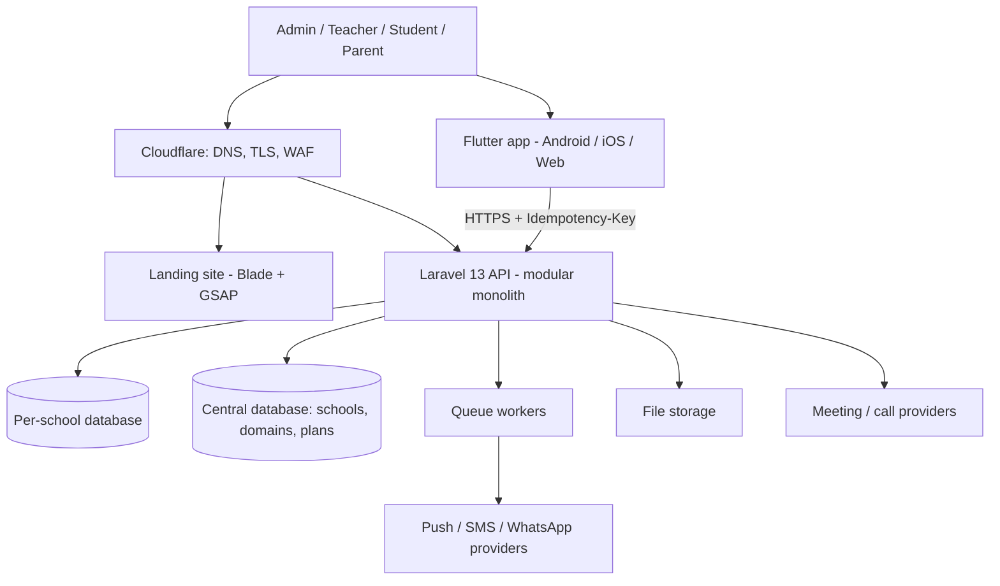
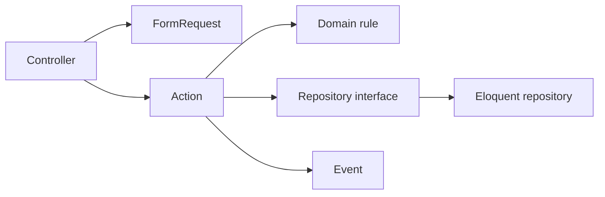

# مُدرّسى (Mudarisy) — Project Engineering Constitution

> The mandatory engineering rules for the Mudarisy platform: a multi-school learning-management SaaS
> (Laravel API + Flutter mobile app + landing site).
>
> This is a rebuild of the generic "LMS Engineering Constitution + xAPI" for **our** platform. It keeps the
> technical architecture and the learning domain (courses, lessons, students, attendance, assessments,
> learning records) and drops everything that belonged to a different product (single-teacher course
> selling, checkout/order funnels, DRM video delivery, Next.js frontend, RAG assistant as a launch need).
> Business requirements are supplied separately and are implemented according to these rules.
>
> **Status markers.** Each rule is tagged **[NOW]** (true of the code today), **[TARGET]** (where we are
> heading; build toward it, do not pretend it exists) or **[WHEN NEEDED]** (do not build until a real
> requirement appears — YAGNI).

---

# 1. Mission

Mudarisy lets many schools, academies and tutoring centres run their daily work from one platform:

- Schools (tenants), each with its own data, domain, plan and enabled modules
- Roles: admin, teacher/staff, student, parent
- Groups (classes), schedules, lesson days
- Students and their cards (QR, face)
- Attendance (QR, face, manual), automatic absence, reminders
- Duties (homework) and the teacher agenda
- Worksheets, assignments, exams, results, exam papers (PDF)
- Fees and payments (desk and online)
- Chat, calls, live sessions
- Notifications (push, SMS, WhatsApp, in-app)
- Reports and dashboards
- Courses, sections and lessons **[WHEN NEEDED]**, learning records (xAPI) **[WHEN NEEDED]**, certificates **[WHEN NEEDED]**

The platform must be built for: strong tenant isolation, offline-first mobile use in weak-network schools,
data integrity, security, observability, maintainability and the ability to grow from tens to thousands of
schools without a rewrite.

---

# 2. Core Architecture

**Modular monolith (Laravel) + multi-tenancy + offline-first Flutter client.** Do not begin with microservices.



**[NOW]** One Laravel app, modules under `Modules/`, school resolved from the request domain, one database per
school, Sanctum bearer tokens, an idempotency middleware for writes.
**[TARGET]** PostgreSQL for central and tenant data in production, Redis for cache/queues/locks, containerised
deploy on a VPS behind Cloudflare, S3-compatible object storage.

---

# 3. Principles

```text
SOLID · KISS · DRY · YAGNI · Separation of concerns · Dependency inversion
Explicit boundaries · Domain-oriented modules · Measure before optimising
Offline-first for field use · Tenant isolation above convenience
```

Architecture solves real problems. Do not add a pattern or technology because it exists.

---

# 4. Technology Stack

## Backend
| Concern | Rule |
|---|---|
| Language / framework | PHP **8.4+** (tested on 8.5), **Laravel 13** — keep on the latest minor |
| Modules | `nwidart/laravel-modules` — one module per domain |
| Tenancy | `stancl/tenancy`; school found by **domain**, never by a request header or body field |
| Auth | Laravel Sanctum personal access tokens; backend authorization is authoritative |
| Database | **[NOW]** SQLite, one file per school + a central file. **[TARGET]** PostgreSQL (schema-per-school or database-per-school; decide with an ADR before migrating) |
| Cache / queue / locks | **[NOW]** file/sync. **[TARGET]** Redis + Horizon (queues below) |
| Quality | Laravel Pint, Larastan (level raised gradually), PHPUnit |
| Dev tooling | `laravel/boost` as a dev dependency; consult it and the installed Laravel docs before writing framework code |

## Mobile
| Concern | Rule |
|---|---|
| Framework | Flutter (Dart), Arabic/RTL first |
| Architecture | MVVM: View → ViewModel (`Command0/Command1`) → Repository → Service |
| State / DI | Riverpod; `config/dependencies.dart` and `config/view_models.dart` are the composition root |
| Offline | `OfflineApiClient` + `Outbox` + `Replica` + `CardDirectory` (section 11) |
| Rules enforced by tests | widgets never import `data/` or `config/`; every declared package is used; no raw colors outside the theme |

## Web / marketing
Blade landing page with self-hosted GSAP + ScrollTrigger. A heavier SPA is **[WHEN NEEDED]**.

## Operations
GitHub Actions, structured logs, an error tracker (Sentry) and operational alerts (Slack or email) **[TARGET]**.

---

# 5. Modules and Ownership

**[NOW]** modules: `Attendance, Auth, Calls, Chat, Core, Exams, Groups, Learning, Notifications, Payments,
PluginStore, Reports, Students, Tenancy`.

```text
Tenancy        schools, domains, plans, module activation, school locking
Auth           users, roles, tokens, trial/expiry/disable controls
Students       students, cards (QR token, face template), student accounts
Groups         groups (classes), schedules, sessions of the day
Attendance     attendance records, scans, automatic absence, session reminders
Learning       duties (homework), agenda, worksheets, assignments
Exams          exam results, departments, question bank, exam paper PDFs
Payments       fees, payments, desk QR check-in, online payment gateways
Chat / Calls   conversations, live calls and meeting providers
Notifications  inbox, push/SMS/WhatsApp channels, device tokens
Reports        dashboards and summaries (read-only)
PluginStore    module catalogue and per-school installed modules
Core           shared kernel: base controllers, idempotency, helpers
```

Rules:
- A module owns its behaviour, tables and routes. Another module may call its **public actions/contracts**
  or listen to its events — never reach into its models' internals or tables.
- New domains get a new module. Courses/lessons/certificates will be their own modules when requested.
- Keep the module list honest: update this section when a module is added or removed.

Recommended module layout (create folders only when they hold something real):

```text
Modules/<Name>/
├── Database/{Migrations,Seeders,Factories}
├── routes/api.php
├── Providers/
├── Http/{Controllers,Requests,Resources}
├── Models/  DTOs/  Actions/  Services/  Repositories/{Contracts,Eloquent}/
├── Policies/  Events/  Listeners/  Jobs/  Notifications/
└── Tests/{Feature,Unit}
```

---

# 6. Multi-Tenancy (the rule that outranks convenience)

1. **Isolation is absolute.** Every query that touches school data runs inside the school's tenant context.
   A bug that shows one school another's data is a security incident.
2. **Resolve the school from the domain** (`{school}.platform` or a custom domain). In production a
   request on an unknown or central domain gets 404. `DEFAULT_SCHOOL` exists for local/testing only and
   must never be set in production.
3. A school has: slug, domains, plan (student limit, enabled modules), state (active/locked). A locked
   school gets a clear refusal on every request.
4. The tenant database prefix, domains and plan limits come from configuration/central data, never from
   user input.
5. Tests: the isolation suite (`SchoolIsolationTest`) must pass with `DEFAULT_SCHOOL` **unset**.
6. Cache keys, queue jobs, files and logs are tenant-scoped (prefix with the school id).
7. Plan limits (e.g. students) are enforced in the backend, not only in the app.
8. Trial / temporary accounts carry `expires_at` / `disabled_at`; an expired or disabled account loses its
   sessions immediately and cannot sign in. Trial limits (groups, students, blocked writes, devices) live in
   `config/trial.php` and are enforced by middleware.

---

# 7. Layering, SOLID, Patterns



- **Controllers** are thin: validate, authorise, call one Action, return a Resource.
- **Actions / use cases** hold one coherent business operation: `RecordAttendance`, `ScanStudentCard`,
  `CreateDuty`, `SubmitAssignment`, `RecordPayment`, `RegenerateStudentCard`, `EnrollStudent`,
  `CompleteLesson` **[WHEN NEEDED]**, `IssueCertificate` **[WHEN NEEDED]**.
- **DTOs** only at meaningful boundaries (many fields, crosses a module or a queue). No DTO for one primitive.
- **Repositories** only where they pay for themselves (complex queries, aggregates, multiple implementations).
  Do not create one per model by reflex; KISS beats pattern.
- **SOLID is mandatory**: no giant `StudentService`; interfaces only where a second implementation is real
  (payment gateways, notification channels, meeting providers); implementations honour their contracts.
- **Allowed patterns:** Strategy, Factory, Adapter, State, Specification, Observer/Event, Decorator, Command, Builder.
- **KISS / DRY / YAGNI:** centralise business rules (permissions, status transitions, attendance calculation,
  plan limits, duty/agenda visibility); do not centralise things that merely look alike. Do not introduce Kafka,
  Kubernetes, Elasticsearch, a vector DB, CQRS or event sourcing without a measured need.

---

# 8. Data and Database Rules

- Normalised relational design; controlled denormalisation only with a measured benefit and a defined
  consistency story.
- Index every frequently executed query; avoid N+1, unbounded queries and `SELECT *` on hot paths.
- Money is stored as integer minor units or fixed decimals — never floats. Currency is explicit.
- Time is stored in UTC; the school's timezone is applied at the edge. (The app also stamps offline writes
  with the device time — see section 11.)
- Never load large sets into PHP memory: paginate, cursor-paginate, chunk or stream.
- Migrations are backward compatible (expand → migrate → contract). Dropping or renaming a column is a
  two-release change. Tenant migrations run per school (`tenants:migrate`).
- Foreign keys and unique constraints express invariants (one attendance per student per session,
  one card token per student, unique idempotency keys).
- High-volume tables (attendance events, audit logs, notification events, learning events, xAPI statements)
  are designed for growth: indexes, retention rules, and partitioning only after access patterns are known.
- Seed/demo data lives in seeders and factories only.

---

# 9. Caching, Queues, Jobs, Async

- Redis is for cache, queues, rate limits and locks — **never** the source of truth.
- Every cache entry defines key (tenant-scoped), TTL, invalidation rule and fallback. Do not cache money state carelessly.
- Queues **[TARGET]**: `critical`, `default`, `payments`, `notifications`, `reports`, `media`, `xapi`.
  A slow workload must not block a critical one.
- Every important job defines timeout, tries, backoff, idempotency, failure behaviour and logging. Assume it
  runs more than once.
- Keep requests fast. Heavy work (PDF exam papers, bulk notifications, Excel import, reports, xAPI delivery)
  is: persist state → dispatch job → return.
- Jobs, events and notifications that depend on committed data run **after commit**.
- Every external API call has a timeout, retry with backoff, error classification (never retry permanent
  failures) and logging.

---

# 10. Transactions, Idempotency, State Machines

- Important operations run in a short database transaction: recording a payment, enrolling, submitting an
  exam, scanning attendance, issuing a certificate, changing plan limits.
- Never hold a transaction open across an HTTP call, a push/SMS call, PDF generation or an AI call.
  Pattern: external work → persist → transaction → commit → dispatch follow-ups.
- **Every write that a client can retry is idempotent.** The mobile app sends an `Idempotency-Key`; the
  `IdempotentRequests` middleware answers a repeat with the original response. Duplicates must not create
  duplicate students, attendance, payments, duties or notifications.
- Webhooks (payments, meetings, SMS delivery) are idempotent by provider event id, with unique constraints
  and explicit state.
- Model lifecycles as **explicit state machines**, not clusters of booleans. Examples:
  `payment: pending → processing → paid | failed | refunded | cancelled`,
  `attendance session: scheduled → open → closed | cancelled`,
  `attendance record: present | late | absent | excused`,
  `school: active | locked`, `certificate: eligible → issued → revoked | expired` **[WHEN NEEDED]**.

---

# 11. Offline-First Mobile Contract

The app must work in schools with weak or no internet. This is a core product promise, so it is an
architectural rule, not a feature.

1. **Reads** are served in this order: replica (when it holds pending replicated writes), network, LRU
   cache, replica, card directory.
2. **Writes** go through the `Outbox`: the call is stored, answered locally with a "queued" promise, applied
   to the `Replica` so the screens show it at once, and replayed later in order with the same
   `Idempotency-Key` and an `X-Offline-Replay` header.
3. Records created offline get a **negative temporary id**; when sent, the server's id replaces it
   everywhere (`localId` rewrite, `pendingLocalIds`).
4. A rejected or discarded write triggers a resync so the replica converges on the server.
5. **Cards and QR work offline**: student card tokens are created on the device (the secret in the request
   is the one the server keeps), kept in the `CardDirectory`, and recognised locally.
6. The server must accept late writes safely: honour device timestamps (`scanned_at`, `occurred_at`),
   confirm a scan made outside the session window when replayed (the staff member could not be asked), and
   stay idempotent.
7. Operations that are only meaningful live — calls, chat, online payment, sign-in — fail with a clear
   Arabic message when offline, never silently.
8. Every new offline-capable write adds: an `OfflineRule` (label, topics, promised response, replicated
   flag), `Replica` read/write support, a local-mode route, and tests for each.
9. Local (demo) mode — `LocalApiClient` over `LocalDatabase` — mirrors the real API's response shapes;
   keep the two in step. A backend contract test suite runs against both.

---

# 12. Learning Domain

## 12.1 Students and cards
- A student belongs to a school and (usually) a group. Account credentials, parent links and the QR/face card
  are separate concepts.
- A card is identified by a secret token; regenerating invalidates the old one. Raw tokens are never logged.
- Face templates are biometric data: store only templates, protect them, allow deletion, never expose them
  to other roles.

## 12.2 Groups and schedules
- A group has days, start/end time and a teacher. "Today's sessions" and reminders derive from it.

## 12.3 Attendance (a business domain, not just analytics)
- Entities: attendance session (**[TARGET]** explicit), attendance record, attendance event/evidence.
- **Sources are recorded:** `qr`, `face`, `manual`, `meeting_provider`, `import`, `system` (automatic absence).
- Records: `present | late | absent | excused` (+ `partial` for timed live sessions when needed).
- Calculation rules (minimum percentage, allowed absences, late threshold) are explicit configuration, and
  are never invented without a requirement.
- Do not rely on client-reported duration alone; keep enough evidence to audit (who, when, source,
  verified_by).
- Duplicate scans/check-ins are harmless (idempotent). Late/offline scans are accepted per section 11.
- Automatic absence sweeps and session reminders are idempotent and safe to run repeatedly.

## 12.4 Duties and the teacher agenda
- **Duties** are homework per group and lesson day; students see their group's duties; staff manage them.
- **Agenda** items are the teacher's own notes/tasks for a group on a day (same shape and logic as duties).
  A teacher sees only their own; the admin sees all. Staff only.
- Reminders are sent once per duty (`reminded_at`) from a lead time before the lesson.

## 12.5 Assessments
- Exams, results, worksheets and assignments: submission and grading are transactions; results are
  immutable once published except through an audited correction.
- Exam papers (PDF) are generated asynchronously and reproducibly from stored templates.

## 12.6 Courses, lessons, sections **[WHEN NEEDED]**
- If courses are added: `Course → Section → Lesson`, with a published/draft/archived state machine,
  explicit **course versioning** (a learner's progress and certificate reference the version they took),
  and an explicit **completion** concept (never inferred from "watched a video").
- Media (video/audio/documents) lives in object storage behind signed, expiring URLs; transcoding is async.

## 12.7 Payments and fees
- Fees and payments are per student and school. A payment has an explicit state machine, an
  integer amount and a currency.
- Gateways implement one `PaymentGatewayInterface` (create, verify, refund, handle webhook); provider SDK
  code stays isolated in adapters. Desk payments (QR check-in) and online payments share the same payment
  model.
- Never log card data or tokens. Webhooks are verified and idempotent. A duplicate webhook must not duplicate
  a payment or a receipt.

## 12.8 Certification **[WHEN NEEDED]**
- A dedicated module with a composable rules engine (`CertificationRuleInterface`: completion, attendance,
  assessment, payment, manual approval) — no giant `canReceiveCertificate()`.
- Issuance is idempotent (unique constraint + state), transactional, and preserves an **eligibility
  snapshot** (scores, attendance %, rule version, course version, issuer, time) so a historical certificate
  stays explainable.

---

# 13. Learning Records (xAPI) **[WHEN NEEDED]**

Build this only when a school or partner requires standardised learning records. When built, these rules apply.

- The platform is an **xAPI Activity Provider** (target xAPI 2.0 / IEEE 9274.1.1); a separate **LRS** stores
  statements. The LRS is not the transactional database.
- The LMS stays **authoritative** for enrollment, access, payments, progress, attendance, results and
  certificates. **Never** make a decision (certificate, access) depend only on an LRS statement.
- Statement = actor (school-scoped account, never raw email), verb, object, result, context, timestamp.
- **Vocabulary is governed centrally.** No ad-hoc verbs; custom verbs are documented first. Useful events:
  registered, enrolled, launched, started, completed, attempted, answered, passed, failed, attended, left,
  mastered, certified.
- Track meaningful events only (attendance recorded, lesson/exam completed), never every UI tap.
- Delivery is **asynchronous** with retry, backoff, a failure/dead-letter state, idempotency, delivery
  status and monitoring. For critical events use an **outbox table** written in the same transaction as the
  business change, drained by a worker.
- Privacy: minimise personal data in statements, honour retention and deletion, never put secrets or
  biometric data in a statement.

---

# 14. Notifications and Messaging

- Channels behind one interface: in-app, push (FCM), SMS, WhatsApp, email. Each school configures what it uses.
- Notifications are queued, tenant-scoped, de-duplicated (reminders are idempotent) and respect user
  preferences and quiet failures (a failed channel never fails the business operation).
- Chat and calls are live-only features; large media goes to object storage; meeting providers are adapters.
- Operational alerts (Slack/email) are for **actionable** events only: production exception, queue failure,
  payment failure/refund, deployment, security event, tenant locked, LRS/xAPI failure. Do not forward every log.
- Never include secrets, card data, tokens or full personal data in any notification or alert.

---

# 15. API Design

- REST under `/api`, JSON, Arabic user-facing error messages, stable shapes (the mobile client and its
  local mode depend on them).
- Resource classes shape output; FormRequests validate; policies authorise; never return Eloquent models
  with hidden fields exposed.
- Lists are paginated (default 100 max) and filterable; no unbounded lists.
- Writes accept `Idempotency-Key`. Errors use correct status codes: 401 unauthenticated, 403 forbidden,
  404 not found **or not yours**, 409 conflict, 422 validation, 429 rate limit.
- Backward compatibility: published mobile versions live for months. Additive changes only; breaking changes
  need a new version and a deprecation window.
- Rate-limit authentication and expensive endpoints. Correlate every request with a `request_id`.

---

# 16. Security

Every feature considers: authentication, authorisation, **ownership (IDOR/BOLA)**, tenant isolation, XSS,
CSRF where applicable, SSRF, SQL injection, mass assignment, privilege escalation, file upload, webhook
forgery, replay, brute force, API abuse.

- Authentication ≠ authorisation. Backend authorisation is authoritative; never trust ids from the client.
- A teacher sees their own groups/agenda; a student sees only their own data; a parent only their children.
- Passwords are hashed; tokens are revocable; disabling an account revokes its tokens; password change signs
  out other devices.
- Secrets live in environment/secret stores, never in the repo, logs or the app binary. Production runs with
  `APP_DEBUG=false`.
- Uploads: validate MIME, extension, size and owner; never execute uploads; store large files in object storage.
- Privacy: collect the minimum; students are often minors — protect their data, honour deletion requests,
  keep a retention policy, and keep biometric data tightly controlled.
- Signing keys for the Android release live outside the repo (`key.properties`, keystore) and are backed up.

---

# 17. Observability and Operations

- **Structured logs** with: `request_id, school, user_id, module, action, resource, duration, severity`.
  Never log secrets or personal data beyond what is needed.
- Health checks: liveness and readiness (database, queue, storage).
- Error tracking (Sentry) **[TARGET]**; metrics for latency (P95/P99), error rate, queue depth/latency,
  database and cache health, push/SMS delivery.
- Backups: scheduled, encrypted, **restore-tested**. Per-school databases are backed up individually.
- **No local state** on production instances: no reliance on local files, sessions, cache or manual edits.
  Instances must be replaceable (1 or N).
- **[NOW]** the platform may run on a single machine behind a tunnel for demos; production is a managed VPS
  with automatic restart, not a developer PC.

---

# 18. CI/CD and Quality Gates

- GitHub Actions run on every push/PR: Pint, Larastan, PHPUnit (with `DEFAULT_SCHOOL` unset for the
  isolation suite), `flutter analyze`, `flutter test`, dependency audit (`composer audit`, `flutter pub`).
- Merge requires green CI. No skipping hooks, no disabling tests to pass.
- Migrations are checked: they run on an empty database and on a copy of production-shaped data.
- Deploy: build → migrate (backward compatible) → switch → health check → keep a rollback path.
  The mobile app is released as a signed APK/AAB; the public download lives behind the site.
- Branching: feature branches, small commits, clear messages; never commit secrets or generated build output.

---

# 19. Testing

Levels: unit, feature/API, authorisation, job, contract, widget, end-to-end where it earns its keep.
Business rules must be testable without a browser or a device.

Mandatory, high-confidence tests for:
- Authentication, authorisation and **tenant isolation**
- Trial/expiry/disable controls and trial limits
- Attendance: scan, duplicate scan, late/offline replay, manual edit, automatic absence
- Duties and agenda visibility per role
- Payments: state transitions, webhooks and duplicates
- Exams: submit, grade, results visibility
- Idempotency of every retried write
- **Offline layer**: outbox ordering, temp-id rewrite, replica convergence, card recognition offline
- Local mode ↔ real API contract parity
- When built: course completion, certification, xAPI delivery

Load-test the critical paths before a real launch (login, group list, attendance scan, payment) and measure
requests/sec, P95/P99, error rate, CPU, memory, DB and queue load. Never claim a capacity that was not measured.

---

# 20. Development Protocol (for humans and AI assistants)

1. **Analyse before coding:** read the existing module and follow its patterns. Do not invent code that
   does not exist; verify names, routes and files first.
2. **Change only what was asked.** No unrequested refactoring. Keep diffs reviewable.
3. **Match the surrounding code** (naming, comment density, structure, Arabic copy tone).
4. **Verify changes:** run the relevant tests, the analyzer and, for UI, the screen itself. Report failures
   honestly.
5. **Definition of Done:** requirement met · authorisation and tenant isolation checked · idempotent where
   retried · offline behaviour defined · tests added · analyzer clean · docs/ADR updated if architecture
   changed · migration backward compatible · no secrets · observability added for new failure modes.
6. **Architecture Decision Records:** significant decisions (database engine, queue, tenancy model, LRS)
   get a short ADR under `docs/adr/` with context, decision, alternatives, consequences.
7. Keep this constitution current: when the platform changes, update the **[NOW]** markers.

---

# 21. Final Boundaries

- Start as a modular monolith; extract a service only for a measured reason (isolation, scaling, team
  ownership, failure containment).
- The AI assistant/RAG service, a dedicated search engine, and a separate analytics store are
  **[WHEN NEEDED]**. If AI is added: run it as a separate service, scope all retrieval by school and role,
  cap cost per school, log usage, and never let it bypass authorisation.
- Correctness, tenant isolation and data safety come before speed of delivery; simplicity comes before
  cleverness.

**Final rule:** when a rule here conflicts with a simpler solution that is correct, secure, tenant-safe and
testable, choose the simpler solution and record why.
