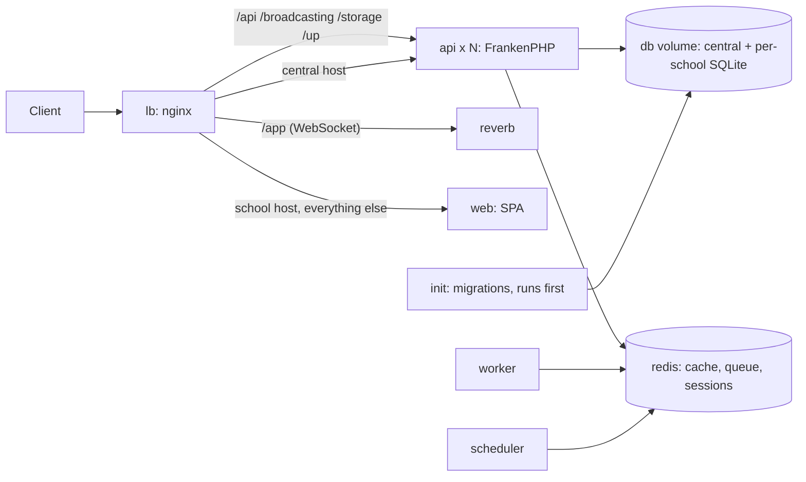

# Deploying Mudarisy

One host runs the whole stack with Docker Compose. nginx load-balances every
request across N stateless API replicas; data lives on shared volumes.



| Service | What it does |
|---|---|
| `lb` | nginx 1.28. School hosts get the web app, with API paths balanced (`least_conn`) over every `api` replica; the central host and the bare IP get Laravel. Re-resolves replicas every 10 s. |
| `api` | Laravel on FrankenPHP, `API_REPLICAS` copies (default 3). |
| `init` | One-shot, runs before `api`: refreshes code-owned `database/` files on the volume, runs central + per-school migrations. |
| `reverb`, `worker`, `scheduler` | WebSockets, queue worker, `schedule:work`. |
| `redis` | Cache, queues, sessions (`noeviction`, AOF on). |
| `web` | The `front-end-service` SPA (built image from that repo). |

**SQLite and replicas.** Every replica shares the `db` volume on this one host.
WAL mode, a 10 s busy timeout, and `IMMEDIATE` transactions keep concurrent writers
safe. Spreading replicas over several hosts needs PostgreSQL first (constitution §9:
decide the tenancy mapping in an ADR before migrating).

## Files

| File | Purpose |
|---|---|
| `docker-compose.yml` | The stack |
| `nginx/default.conf.template`, `nginx/proxy-headers.inc` | Load balancer config (`CENTRAL_HOST`, `PUBLIC_IP` filled in at start) |
| `compose.env.example` → `.env` | Image tags, replica count, hosts (not secret) |
| `.env.production.example` → `.env.production` | App config and secrets. Never committed. Create with `make-env.sh`. |
| `make-env.sh` | Writes `.env.production` with fresh secrets; refuses to overwrite |
| `deploy.sh` | Rolls one image forward, smoke-tests, rolls back on failure |
| `smoke-test.sh` | End-to-end checks through the load balancer |

## Run locally

```bash
docker build -t mudarisy-api:local ..                      # from laravel-backend/
docker build -t mudarisy-web:local ../../../front-end-service
cp compose.env.example .env
./make-env.sh mudarisy-api:local api.mudarisy.localhost mudarisy.localhost
docker compose up -d --wait
docker compose exec api php artisan school:create demo --admin-email=you@example.com --admin-password='...'
./smoke-test.sh http://localhost api.mudarisy.localhost demo.mudarisy.localhost
```

## CI/CD

`.github/workflows/ci.yml` (this repo) runs the Laravel tests and `composer audit`. It
then builds the image, starts this stack with 3 replicas, opens a school, and runs
`smoke-test.sh`. On `main` it pushes `ghcr.io/<owner>/mudarisy-api:<sha>` and runs
`deploy.sh API_IMAGE …` on the server over SSH. `front-end-service` does the same for
`WEB_IMAGE`.

Repository secrets (both repos, `production` environment):
`DEPLOY_HOST`, `DEPLOY_USER` (`deploy`), `DEPLOY_SSH_KEY` (private key of the CI
deploy key), `DEPLOY_KNOWN_HOSTS` (`ssh-keyscan <host>` output).

Roll back by hand: edit `API_IMAGE`/`WEB_IMAGE` in `/opt/mudarisy/.env` to an earlier
tag and `docker compose up -d --wait`. Migrations must stay backward compatible
(constitution §9), so older code keeps working against a newer schema.

## Known limits

- `docker compose up` replaces all API replicas at once: expect a few seconds of 502s per backend deploy.
- No TLS on the origin yet. Put Cloudflare (proxied, Full mode with an Origin certificate) in front before real users.
- LiveKit (calls) is not in this stack yet; `livekit.yaml` is the starting point.
