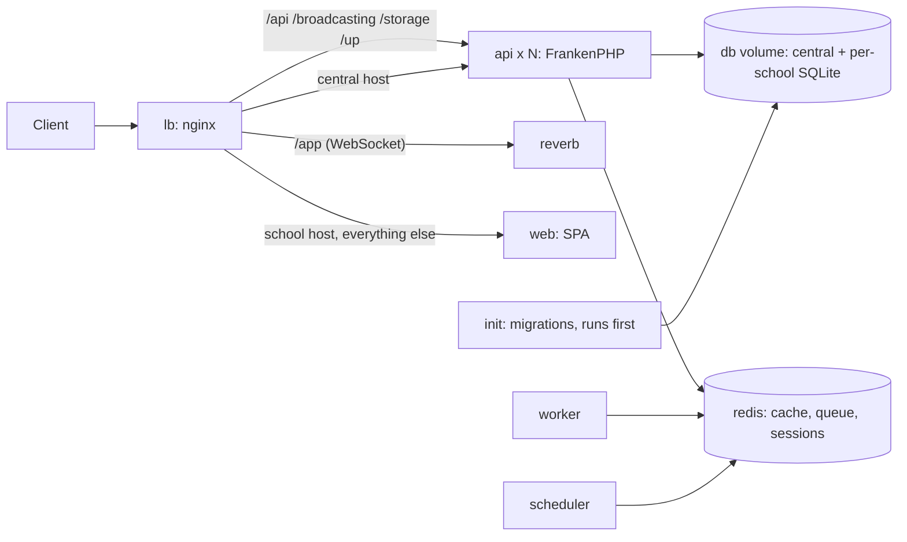

# Deploying Mudarisy

One host runs the whole stack with Docker Compose. nginx load-balances every
request across N stateless API replicas; data lives on shared volumes.



| Service | What it does |
|---|---|
| `lb` | nginx 1.28. School hosts get the web app, with API paths balanced (`least_conn`) over every `api` replica; the central host and the bare IP get Laravel. Re-resolves replicas every 10 s. |
| `api` | Laravel on FrankenPHP, `API_REPLICAS` copies (default 3). |
| `init` | One-shot, runs before `api`: refreshes code-owned `database/` files on the volume, runs central + per-school migrations. |
| `reverb`, `worker`, `scheduler` | WebSockets, queue worker, `schedule:work`. |
| `redis` | Cache, queues, sessions (`noeviction`, AOF on). |
| `web` | The `front-end-service` SPA (built image from that repo). |

**SQLite and replicas.** Every replica shares the `db` volume on this one host.
WAL mode, a 10 s busy timeout, and `IMMEDIATE` transactions keep concurrent writers
safe. Spreading replicas over several hosts needs PostgreSQL first (constitution §9:
decide the tenancy mapping in an ADR before migrating).

## Files

| File | Purpose |
|---|---|
| `docker-compose.yml` | The stack |
| `nginx/default.conf.template`, `nginx/proxy-headers.inc` | Load balancer config (`CENTRAL_HOST`, `PUBLIC_IP` filled in at start) |
| `compose.env.example` → `.env` | Image tags, replica count, hosts (not secret) |
| `.env.production.example` → `.env.production` | App config and secrets. Never committed. Create with `make-env.sh`. |
| `make-env.sh` | Writes `.env.production` with fresh secrets; refuses to overwrite |
| `deploy.sh` | Zero-downtime rollout of one image, smoke test, instant switch-back on failure |
| `nginx/upstreams/*.inc` | Server lists for the `api` and `web` upstreams (`deploy.sh` rewrites them during a rollout) |
| `nginx/site.inc` | Locations shared by the HTTP (80) and HTTPS (443) servers |
| `nginx/cloudflare-*.inc`, `update-cloudflare-ips.sh` | Cloudflare's published IP ranges, used to trust visitor IP and scheme headers |
| `make-certs.sh` | Creates `certs/origin.key`/`origin.pem` (self-signed until the Cloudflare Origin certificate is installed) |
| `smoke-test.sh` | End-to-end checks through the load balancer |

## Run locally

```bash
docker build -t mudarisy-api:local ..                      # from laravel-backend/
docker build -t mudarisy-web:local ../../../front-end-service
cp compose.env.example .env
./make-env.sh mudarisy-api:local api.mudarisy.localhost mudarisy.localhost
docker compose up -d --wait
docker compose exec api php artisan school:create demo --admin-email=you@example.com --admin-password='...'
./smoke-test.sh http://localhost api.mudarisy.localhost demo.mudarisy.localhost
```

## CI/CD

`.github/workflows/ci.yml` (this repo) runs the Laravel tests and `composer audit`. It
then builds the image, starts this stack with 3 replicas, opens a school, and runs
`smoke-test.sh`. On `main` it pushes `ghcr.io/<owner>/mudarisy-api:<sha>` and runs
`deploy.sh API_IMAGE …` on the server over SSH. `front-end-service` does the same for
`WEB_IMAGE`.

Repository secrets (both repos, `production` environment):
`DEPLOY_HOST`, `DEPLOY_USER` (`deploy`), `DEPLOY_SSH_KEY` (private key of the CI
deploy key), `DEPLOY_KNOWN_HOSTS` (`ssh-keyscan <host>` output).

### How a rollout works (`deploy.sh`)

1. Checks the nginx config, pulls the image, and (for the API) runs migrations in `init`.
2. **Pins** nginx to the running replicas, then starts as many new ones beside them.
   New replicas take no traffic until their health check passes; if they never do,
   they are removed and nothing else changes.
3. **Switches** nginx to the new replicas with a graceful reload (no dropped requests),
   keeping the old ones running.
4. **Smoke-tests** through the load balancer. On failure it switches straight back to
   the old replicas (a reload, under a second) and removes the new ones.
5. **Retires** the old replicas, points nginx back at the whole service, and restarts
   Reverb, the worker and the scheduler on the new image.

Measured locally with three request streams running throughout: a normal API or web
rollout dropped 0 of ~1,500 requests; an image that never became healthy, 0; a healthy
image with broken pages was live only for the few seconds of the smoke test.

Roll back by hand with `./deploy.sh API_IMAGE <previous tag>` (the same zero-downtime
path). Migrations must stay backward compatible (constitution §9), so older code keeps
working against a newer schema.

## HTTPS and Cloudflare

Visitors reach Cloudflare over HTTPS; Cloudflare connects to this host on **443** (or 80). nginx
takes the visitor's real IP from `CF-Connecting-IP` and the scheme from `X-Forwarded-Proto`
**only when the TCP peer is inside Cloudflare's published ranges**, so a request sent straight
to the origin cannot choose the address that rate limits and logs record. `X-Forwarded-For` is
always overwritten with that address, never appended to. Refresh the ranges occasionally with
`./update-cloudflare-ips.sh`, review the diff, commit and deploy.

One-time setup, in the Cloudflare dashboard for the zone:

1. **DNS**, both *Proxied*: an `A` record `api` and one `*` pointing at the server's IP. Existing records win over the wildcard, so apex, `www`, mail and so on are unaffected. (If the plan refuses a proxied wildcard, add one proxied record per school instead.)
2. **Origin certificate:** *SSL/TLS, Origin Server, Create Certificate, Use my private key and CSR.* Paste `/opt/mudarisy/certs/origin.csr` from the server, keep the hostnames `mudarisy.com` and `*.mudarisy.com`, and save the PEM Cloudflare returns as `/opt/mudarisy/certs/origin.pem`. The private key never leaves the server. Then `docker compose exec lb nginx -s reload`.
3. **SSL mode:** *SSL/TLS, Overview, Full (strict)*.

Until step 2 the origin serves a self-signed certificate, which Cloudflare accepts in *Full* (not
*strict*). Until DNS exists the stack stays reachable on its `<ip>.sslip.io` names over plain HTTP.

## Known limits

- Changing the `lb` service definition itself (ports, mounts) recreates it: about a second of refused connections.
- LiveKit (calls) is not in this stack yet; `livekit.yaml` is the starting point.
